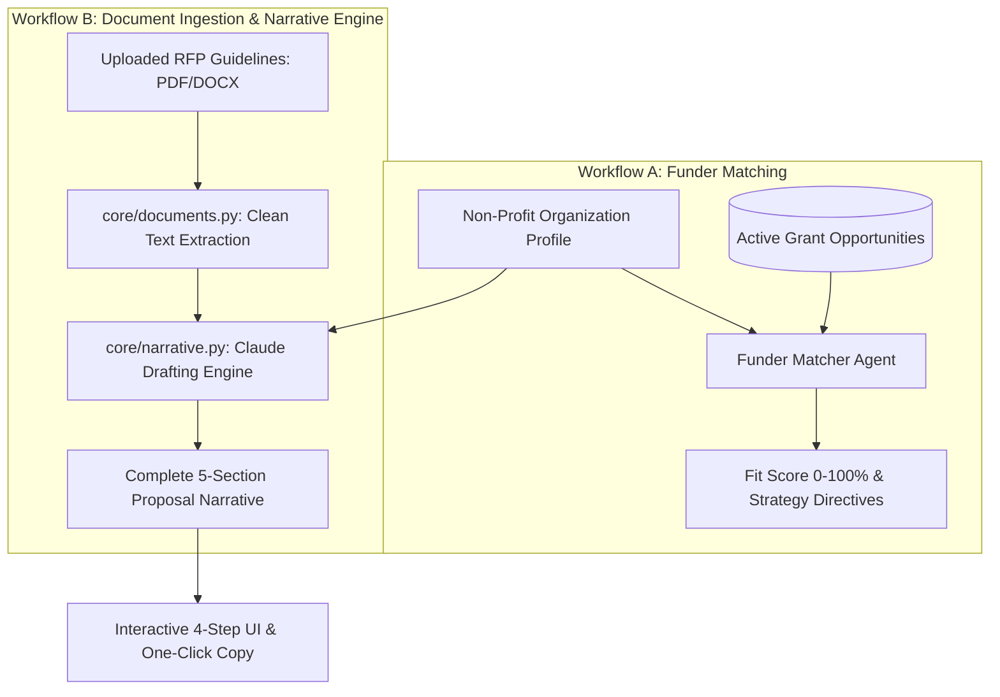

# 🎯 GrantPilot — Non-Profit Grant Matching & Narrative Drafting Playbook
PLAYBOOK.md — Operations, Proposal Strategy & Standard Operating Procedures

This playbook defines the master operational procedures, document ingestion workflows, funder alignment scoring rules, and proposal narrative generation for **GrantPilot**.

---

## 1. 💼 Executive Overview & Business Case

### The Problem
Non-profit organizations and educational institutions lose **$250,000+ annually in potential grant funding** due to limited grant-writing bandwidth. Grant writers spend 40–80 hours manually parsing complex 50-page Requests for Proposals (RFPs), aligning mission statements, and drafting proposal narratives.

### The Automated Solution
GrantPilot is an autonomous multi-workflow grant intelligence agent:
* **Workflow A (Funder Matching)**: Cross-references non-profit mission profiles against active grant RFP opportunities to calculate fit scores and strategic recommendations.
* **Workflow B (Document Ingestion & Narrative Drafting)**: Parses uploaded RFP guidelines (PDF, DOCX, TXT), extracts compliance rules, and generates complete, compelling grant narratives (Executive Summary, Statement of Need, Program Design, Measurable Outcomes, Sustainability Plan).

### Quantified ROI & Value
* **Drafting Acceleration**: Cuts grant proposal drafting time from **30 hours to < 2 minutes**.
* **Win-Rate Optimization**: Standardizes narrative alignment against funder scoring rubrics.
* **Non-Profit Affordability**: Built on lightweight serverless architecture with persistent form loading and multi-format document parsing.

---

## 2. 🏗️ System Architecture & Workflow Directives

### Directive System
GrantPilot's behavior is governed by 3 Standard Operating Directives:
1. [`directives/document_upload.md`](directives/document_upload.md): Document parsing, token normalization, and file size limits.
2. [`directives/matching_rules.md`](directives/matching_rules.md): Fit score algorithms and requirement matrices.
3. [`directives/narrative_draft.md`](directives/narrative_draft.md): Proposal structure, tone guidelines, and outcome metric formulations.

---

## 3. 📋 Standard Operating Procedures (SOP)

### SOP-01: Organization Profile Intake & Persistence
1. **Intake**: Non-profit enters Mission Statement, Core Programs, Target Demographics, Annual Budget, and Primary Needs.
2. **Persistence**: The profile is automatically saved via `POST /api/org/save` and loaded into memory on application startup via `GET /api/org/load`.

### SOP-02: Matching Evaluation & Tiering
* 🟢 **High Match ($\ge 80\%$)**: Direct alignment on mission, target population, and funding size. Immediate narrative generation recommended.
* 🟡 **Moderate Match ($60\% - 79\%$)**: Partial alignment; requires customized framing or partner collaboration.
* 🔴 **Low Match ($< 60\%$)**: Significant misalignment on geography, eligibility, or mission scope.

### SOP-03: Proposal Narrative Generation
Every drafted narrative must produce 5 compliant sections:
1. **Executive Summary**: High-impact problem overview and funding request amount.
2. **Statement of Need**: Localized data, demographic statistics, and community pain points.
3. **Program Design & Implementation**: Step-by-step project activities, milestones, and timeline.
4. **Measurable Outcomes & Evaluation**: Specific SMART KPIs and tracking methodologies.
5. **Budget Narrative & Sustainability Plan**: Responsible resource allocation and post-grant continuity.

---

## 4. 🛡️ Guardrails, Security & Integrity

* **Factual Grounding**: The narrative engine strictly relies on the organization's entered profile data to prevent fabricated organizational history or fake past accomplishments.
* **Persistent Cache Management**: Local cache files in `data/` maintain state across restarts without external database costs.
* **Clean Encoding**: Cross-platform support for Windows, macOS, and Linux with automated encoding fallback.

---

## 5. 🚨 Human Review & Editing Protocols

| Step | AI Output | Human Grant Writer Review |
| :--- | :--- | :--- |
| **Funder Match Score** | Generates fit score and strategic rationale | Reviewer confirms grant submission deadline. |
| **Statement of Need** | Drafts community impact narrative | Reviewer inserts specific local census or organizational figures. |
| **Budget Narrative** | Drafts funding allocation narrative | Finance Director approves line-item budget table before submission. |

---

## 6. 🚀 Deployment & Operational Checklist

- [ ] **Dependencies**: `pip install -r requirements.txt` (FastAPI, uvicorn, PyMuPDF, python-docx, anthropic).
- [ ] **Environment**: Configure `ANTHROPIC_API_KEY` and optional `ANTHROPIC_MODEL` in `.env`.
- [ ] **Automated Testing**: Run unit and integration tests to verify API endpoints.
- [ ] **Launch Server**: `python -m uvicorn main:app --reload` (served on `http://localhost:8000`).

---

## 7. 💬 Stakeholder FAQ

**Q: Can GrantPilot ingest 40-page federal RFP grant guidelines?**  
*A: Yes. The document parser strips formatting noise and extracts key requirements, evaluation rubrics, and deadlines for the narrative drafting engine.*

**Q: Does GrantPilot store our proprietary grant narratives publicly?**  
*A: No. All profiles and drafted narratives stay on your local server instance and are never shared or published.*
